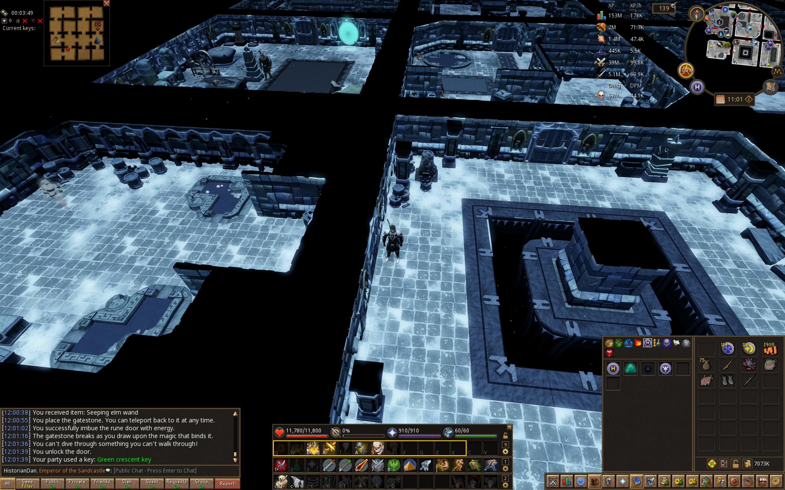
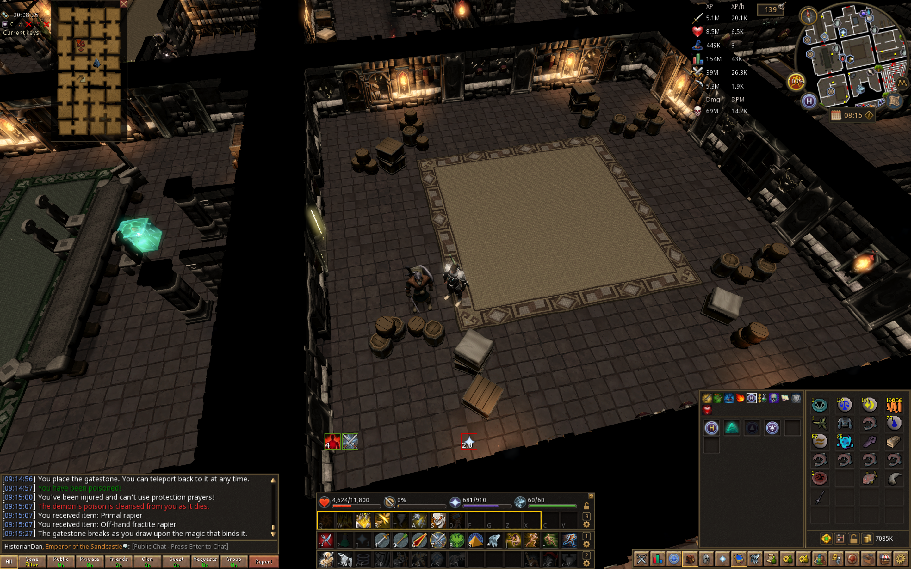

# Update:Dungeoneering Skill! - 12 April 2010

[Update post](https://runescape.wiki//w/Update:Dungeoneering_Skill!)

## Locations

- Daemonheim

## Goals

### Skill

#### Dungeoneering level goals

- [x] 69 Dungeoneering - *Reach level 35 dungeoneering.*
- [x] (!Optional) 80 Dungeoneering - *Legacy requirement for chaotics* (#Legacy)
- [ ] (!Optional) 99 Dungeoneering - *Wear the Dungeoneering cape*

#### Non 99 skill goals

- [ ] 95 Farming - *Harvest a Buckthorn*
- [x] 90 Firemaking - *Burn a Grave Creeper branch*
- [ ] 90 Fishing - *Catch a Raw cave moray*
- [ ] 90 Hunter - *Tyrannomastyx*
- [x] 90 Mining - *Promethium ore*
- [x] 90 Thieving - *Openning the hardest chests.*

#### Level 99 combat goals

- [ ] 99 Attack - *Primal weapons*
- [ ] 99 Strength - *Primal maul*
- [ ] 99 Defence - *Tier 11 dungeoneering armour*
- [ ] 99 Ranged - *Sagittarian longbow*
- [x] 99 Magic - *Celestial catalytic staff*
- [ ] 99 Summoning - *Sachem skinweaver*

#### Level 99 non-combat goals

- [ ] 99 Cooking - *Cook a moray and edicap potato*
- [ ] 99 Crafting - *Tyrannoleather	body*
- [ ] 99 Fletching - *Promethium arrows*
- [ ] 99 Herblore - *Strong survivalist's potion*
- [ ] 99 Runecrafting - *Empowered catalytic staff*
- [ ] 99 Slayer - *Kill a Soulgazer*
- [x] 99 Smithing - *Promethium platebody*
- [ ] 99 Woodcutting - *Use a Primal axe*

## Equipment in Daemonheim

- [ ] Melee
  - [ ] A primal weapon (main + off-hand / 2h) <!-- I got a primal rapier-->
  - [ ] Primal platebody (Dreadnaut) 
  - [ ] Primal platelegs (Flesh-spoiler Haasghenahk)

- [ ] Ranged
  - [ ] Sagittarian bow (Sagittarian)
  - [ ] Sagittarian body (Hope devourer)
  - [ ] Sagittarian chaps (Necrolord)

- [ ] Magic
  - [x] Celesital catalytic staff
  - [ ] Celesital robe top (Warped Gulega)
  - [ ] Celesital robe bottom (Runebound behemoth)

- [ ] Necromancer
  - [ ] Entropic lanthern (Skeletal Horde)
  - [ ] Entropic guarde (Unholy cursebearer)
  - [ ] Entropic robe top (World-gorger Shukarhazh)
  - [ ] Entropic robe bottom (Shadow-forger Ihlakhizan)

- [ ] Slayer
  - [x] Shadow silk hood (From Nightspiders)
  - [ ] Blood necklace (From Edimmus)
  - [ ] Hexhunter bow (From Soulgazer)

### Equipment (914,000)

- [ ] Dungeoneering cape
- [x] Gravite
  - [x] Gravite rapier
  - [x] Gravite longsword
  - [x] Gravite 2h sword
  - [x] Gravite chargebow
  - [x] Gravite staff
- [ ] Chaotic (200,000)
  - [x] Chaotic rapier
  - [ ] Chaotic longsword (main + off-hand) (200,000)
  - [x] Chaotic maul
  - [x] Chaotic crossbow
  - [x] Chaotic staff
- [ ] Shields (600,000)
  - [ ] Chaotic kiteshield (200,000)
  - [ ] Eagle-eye kiteshield (200,000)
  - [ ] Farseer kiteshield (200,000)
- [ ] Other (114,000)
  - [ ] Tome of frost (43,000)
  - [ ] Mercenary's gloves (48,500)
  - [ ] Law staff (10,000)
  - [ ] Nature staff (12,500)

### Items

- [x] Gem bag
- [x] Longbow sight
- [x] Scroll of life
- [x] Scroll of renewal
- [x] Anti-poison totem
- [x] Bone crusher

### Achievments

- [x] Heal, Quickly

### Others

- [x] Reach the bottom floor of 35.

### Selv made achievments

- [x] (!Optional) Defeat all bosses up to and not including occult.
- [x] (!Optional) Complete every puzzel at least once
- [ ] (!Optional) Complete a floor with the maximum number of rooms of a given size
  - Large

### Pictures

| Size | Picture |
| ---- | ------- |
| Small |  |
| Medium |  |
| Large | Not experienced yet |
